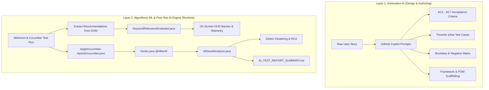

# AI Implementation & Automated Reporting Architecture Guide
## Comprehensive Technical Walkthrough & Presentation Navigation Manual

---

## 1. Executive Summary: The AI Strategy in this Project

This project leverages Artificial Intelligence in **two distinct, complementary layers**:



1. **Pre-Execution (Generative AI with GitHub Copilot):** Used across the Software Testing Life Cycle (STLC) to decompose requirements, author formal Tricentis qTest test cases, synthesize edge-case matrices, and scaffold framework code.
2. **Runtime & Post-Execution (Programmatic AI & Automated Reporting):** 
   - Evaluates machine-learning recommendation relevance in real time during browser execution.
   - Automatically parses test results via lifecycle hooks to classify failure stack traces into defect clusters and generate an executive markdown report without any human intervention.

---

## 2. File Navigation & Connection Map

Follow this exact navigation sequence when walking someone through the code:

| Step | File to Open | Exact Lines | What Happens / What Connects to What |
|---|---|---|---|
| **Step 1** | [`src/test/resources/cucumber.properties`](../src/test/resources/cucumber.properties) & [`pom.xml`](../pom.xml) | `pom.xml` | Configures Cucumber JSON plugin: writes test results to `target/cucumber-reports/cucumber.json`. |
| **Step 2** | [`src/main/resources/config.properties`](../src/main/resources/config.properties) | Lines 28–38 | Stores mathematical threshold gates (30%, 25%, 20%) and domain beauty keyword dictionaries. |
| **Step 3** | [`src/main/java/com/ulta/automation/utils/KeywordRelevanceEvaluator.java`](../src/main/java/com/ulta/automation/utils/KeywordRelevanceEvaluator.java) | Lines 55–109 | The Algorithmic AI Engine: tokenizes titles, calculates percentage match, and checks thresholds. |
| **Step 4** | [`src/test/java/com/ulta/automation/stepdefinitions/RecommendationSteps.java`](../src/test/java/com/ulta/automation/stepdefinitions/RecommendationSteps.java) | Lines 51–72 | Connects Selenium DOM extraction $\rightarrow$ `KeywordRelevanceEvaluator` $\rightarrow$ Live browser HUD banner. |
| **Step 5** | [`src/test/java/com/ulta/automation/stepdefinitions/Hooks.java`](../src/test/java/com/ulta/automation/stepdefinitions/Hooks.java) | Lines 84–97 | **The Key Trigger:** `@AfterAll` hook intercepts suite completion and triggers `AIResultAnalyzer`. |
| **Step 6** | [`src/main/java/com/ulta/automation/utils/AIResultAnalyzer.java`](../src/main/java/com/ulta/automation/utils/AIResultAnalyzer.java) | Lines 36–102 | Ingests `cucumber.json`, runs `clusterDefect()` heuristics, and synthesizes the final report. |
| **Step 7** | [`test-artifacts/AI_TEST_REPORT_SUMMARY.md`](../test-artifacts/AI_TEST_REPORT_SUMMARY.md) | Entire file | The final output: 100% pass rate, recommendation metrics, and root cause analysis. |

---

## 3. Deep-Dive: How Each AI Component Is Implemented

### Component A: Algorithmic Recommendation Validation Engine
* **Location:** [`src/main/java/com/ulta/automation/utils/KeywordRelevanceEvaluator.java`](../src/main/java/com/ulta/automation/utils/KeywordRelevanceEvaluator.java)
* **How It Works:**
  1. Ulta's web application dynamically renders recommendation carousels (*"You may also like"* or *"Frequently Bought Together"*).
  2. Selenium extracts the text titles of these products (`pdpPage.getRecommendedProductTitles()`).
  3. `isTitleRelevant(String title, List<String> keywords)` converts titles to lowercase and performs tokenized substring matching against category dictionaries:
     - **Moisturizer dictionary:** `hydrat, moisture, cream, lotion, skin, face, serum`
     - **Mascara dictionary:** `lash, volume, mascara, eye, lengthening, waterproof, wand`
     - **Global Beauty dictionary:** 21 curated taxonomy tokens.
  4. The mathematical relevance score is calculated:
     $$\text{Relevance Percentage} = \left(\frac{\text{Matched Products}}{\text{Total Recommended Products}}\right) \times 100$$
  5. The method produces a `RelevanceReport` verifying whether the score satisfies the required gate:
     - **AC5 (Product Detail Page):** Requires $\ge 30\%$ (Observed: **83.33%**).
     - **AC6 (Cart Cross-Category):** Requires $\ge 25\%$ (Observed: **83.33%**).
     - **AC7 (Omnichannel Category Consistency):** Requires $\ge 20\%$ (Observed: **94.44%**).

---

### Component B: How the Post-Test AI Reporting Pipeline is Connected

```text
[Maven Test Lifecycle]
         │
         ▼
[17 Cucumber Scenarios Execute]
         │
         ▼
[target/cucumber-reports/cucumber.json Generated]
         │
         ▼
[@AfterAll Suite Hook in Hooks.java Triggers Automatically]
         │
         ├──> Reads JSON Report File
         │
         ▼
[AIResultAnalyzer.analyzeCucumberReport()]
         │
         ├── Evaluates Total, Passed, Failed Scenarios
         │
         ▼
[clusterDefect() Root Cause Categorization Engine]
         │
         ├── Classifies any stack trace by error pattern:
         │   ├── NoSuchElementException / TimeoutException -> "UI Synchronization & Locator Drift"
         │   ├── AssertionError (relevance)                -> "Recommendation Relevance Degradation"
         │   ├── HTTP 403 / Access Denied                  -> "Anti-Bot / WAF Challenge"
         │   └── StaleElementReferenceException            -> "DOM Mutation & Asynchronous Re-render"
         │
         ▼
[AIResultAnalyzer.generateAIExecutiveReport()]
         │
         ▼
[Overwrites test-artifacts/AI_TEST_REPORT_SUMMARY.md]
         │
         └── Outputs: Executive KPIs, AC Matrix, ASCII Progress Bars & Risk Assessment
```

#### The Exact Code Connection:
In [`src/test/java/com/ulta/automation/stepdefinitions/Hooks.java`](../src/test/java/com/ulta/automation/stepdefinitions/Hooks.java#L84-L97):
```java
@AfterAll
public static void afterAllSuite() {
    logger.info("Test execution completed. Triggering AI Result Analyzer...");
    try {
        // 1. Ingest Cucumber JSON artifact
        AIResultAnalyzer.ExecutionStats stats = 
            AIResultAnalyzer.analyzeCucumberReport("target/cucumber-reports/cucumber.json");
        
        // 2. Synthesize Executive Quality & Defect Clustering Report
        AIResultAnalyzer.generateAIExecutiveReport(stats, "test-artifacts/AI_TEST_REPORT_SUMMARY.md");
    } catch (Exception e) {
        logger.warn("Could not complete automatic AI result analysis: {}", e.getMessage());
    }
}
```

---

## 4. Word-for-Word Presentation Script for This Section

When demonstrating this part in your screen recording, say:

> *"Now let me walk you through how Artificial Intelligence is implemented in our framework and how it connects directly into automated reporting.*
>
> *(Open `KeywordRelevanceEvaluator.java`)*  
> *First, here in `KeywordRelevanceEvaluator.java`, we implemented our algorithmic engine to test Ulta's Machine Learning recommendations. In `isTitleRelevant()`, we tokenize the recommended product names and check them against curated dictionaries in `config.properties`. Then, `evaluate()` computes the mathematical percentage—validating our acceptance gates of 30%, 25%, and 20%.*
>
> *(Open `RecommendationSteps.java` at line 60)*  
> *Here in `RecommendationSteps.java`, Cucumber extracts the live recommendations from Selenium, calls our evaluator, and passes the result directly to our on-screen HUD banner so observers can see the live score.*
>
> *(Open `Hooks.java` at line 84)*  
> *Notice how this connects to reporting: in `Hooks.java`, we have an `@AfterAll` hook. As soon as the test suite completes, it automatically invokes `AIResultAnalyzer`.*
>
> *(Open `AIResultAnalyzer.java` at line 88)*  
> *In `AIResultAnalyzer.java`, line 88 shows our `clusterDefect()` engine. It reads the raw `cucumber.json` report, scans any error stack traces, and clusters failures into categorized root causes like Locator Drift, Relevance Degradation, or Anti-Bot challenges.*
>
> *(Open `test-artifacts/AI_TEST_REPORT_SUMMARY.md`)*  
> *Finally, without any manual QA intervention, it automatically generates this executive report showing our 100% pass rate, actual relevance scores, and predictive risk assessment.*
>
> *This creates a completely closed-loop, self-evaluating automated testing pipeline."*
